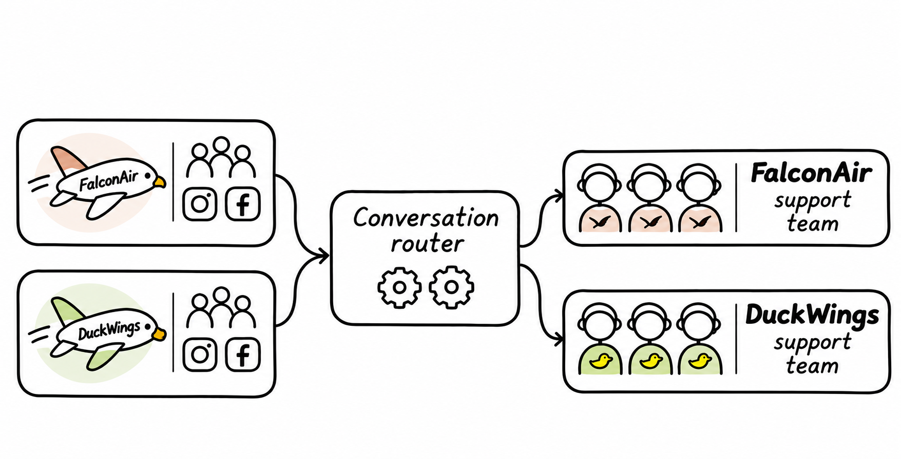

# Conversation router kata

**FalconAir** recently acquired **DuckWings** airline. Customers of both airlines write to the airlines' pages on Facebook and Instagram, and one bot answers on all of them. Until the loyalty programs merge, each airline keeps its own support teams, so for every conversation the conversation router decides which team's queue it goes to.

The routing rules grew one exception at a time: a team per airline, per market and per language, VIP customers, executive mentions, disruptions. Today they all live in one method, `RoutingRules.getAssignedWorkQueue`, and the developers are afraid to touch it.

The kata: refactor that method into code the team can change again, without changing what it does. Use any technique, by hand or with AI.

## Safety net

`RoutingRulesAcceptanceTest` pins today's behavior: about 15,000 combinations of channel, page, brand, verification and tags, recorded in `RoutingRulesAcceptanceTest.pinAll.approved.txt`. A refactoring that changes that file changed behavior.

## Run

1. Install [mise](https://mise.jdx.dev/getting-started.html). It provides the right Java version.
2. Run `./build_and_test.sh`, or `build_and_test.bat` on Windows. The first run downloads Java 25 and Maven.

It ends with `Build and test: Ns, exit 0` when all tests pass.

## Ways to do the kata

- Any refactoring technique, by hand or with AI.
- With Habit Hooks: smell sensors find what to fix next and coach an AI agent through the cleanup. Its docs are on `main`, in `docs/habit-hooks/`.

## Branches

- `main`: the starting code. Start here.
- `ae-november-2026`: a workshop run. An AI agent refactored `RoutingRules` guided by Habit Hooks, then the group started BDD-style approval tests (`RoutingStoryboard`, `RoutingRulesTest`).
- `human-lift-if`: a person refactoring by hand with the Lift-If technique, for comparison. It also removes functionality nothing uses, so its approved file differs from `main`'s.

## More

Where everything is: `docs/map.md`.
